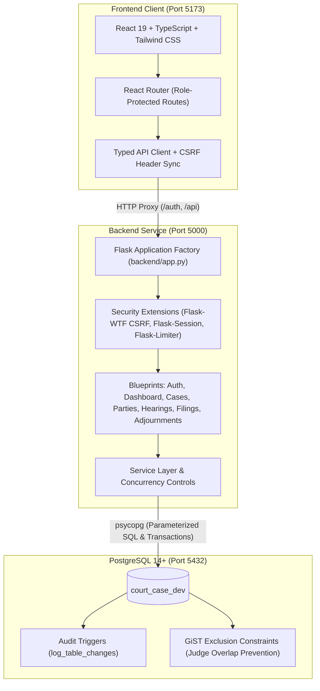

# Court Case Management System (CCMS)

A web-based Court Case Management System designed for structured judicial proceedings, court case tracking, docket management, and role-based operational workflows. Built with a security-hardened Flask backend and a modern React + TypeScript frontend.

> **Project Status:** Academic MVP (Minimum Viable Product). Not intended for direct production deployment without containerized infrastructure, formal SSL termination, and enterprise key management.

---

## Architecture Overview



- **Frontend:** React 19, TypeScript, Tailwind CSS, Lucide icons, Vite.
- **Backend:** Python Flask 3.1+, Werkzeug, Flask-Session (server-side filesystem/Redis sessions), Flask-WTF (double-submit/header CSRF protection), Flask-Limiter, Argon2id password hashing.
- **Database:** PostgreSQL 14+ with `btree_gist` and `uuid-ossp` extensions, append-only audit trail triggers, and transactional concurrency locking.

---

## Role Permissions Matrix

| Capability / Workflow | Admin | Clerk | Judge |
| :--- | :---: | :---: | :---: |
| **System Overview & Metrics** | Full system telemetry | Operational summary | Scoped to assigned docket |
| **View Case Docket** | Global visibility | Global visibility | Only assigned cases (`cases.judge_id`) |
| **Create / Update Cases** | Allowed | Allowed | Forbidden (HTTP 403 Read-Only) |
| **Delete Case Record** | Hard Delete (0 dependencies) | Forbidden (HTTP 403) | Forbidden (HTTP 403) |
| **Manage Parties & Linkage** | Allowed | Allowed | Forbidden (HTTP 403) |
| **Schedule Hearings** | Allowed | Allowed | Forbidden (HTTP 403) |
| **Record Filings** | Allowed | Allowed | Forbidden (HTTP 403) |
| **Record Adjournments** | Allowed | Allowed | Forbidden (HTTP 403) |
| **Audit Log Visibility** | Read-Only Viewer | Excluded | Excluded |
| **User Directory** | Informational Roster | Excluded | Excluded |

---

## Prerequisites

Before running the application, ensure the following software is installed on your host machine:

- **Python:** Version 3.11 or later.
- **Node.js:** Version 20.19+ or 22.12+ (required by Vite 8; includes `npm`).
- **PostgreSQL:** Version 14 or later running on `localhost:5432`.
- **Git:** Standard git version control client.

---

## Database Setup (`court_case_dev`)

> [!CAUTION]
> The database name must strictly be **`court_case_dev`**. The backend enforces hardcoded runtime safety assertions that unconditionally block connections to `court_case_db` or any database name outside `court_case_dev`.

### 1. Create the Database
In PostgreSQL (`psql` or pgAdmin):

```sql
CREATE DATABASE court_case_dev;
```

### 2. Execute the Database Schema
From the repository root directory, load the schema dump:

```powershell
# Windows PowerShell (Option A: Direct file flag if psql is in PATH)
psql -h localhost -p 5432 -U postgres -d court_case_dev -f court_case_schema.sql

# Windows PowerShell (Option B: Stream content through pipeline)
Get-Content court_case_schema.sql | psql -h localhost -p 5432 -U postgres -d court_case_dev
```

```bash
# Linux / macOS / Git Bash
psql -h localhost -p 5432 -U postgres -d court_case_dev -f court_case_schema.sql
```

This creates required extensions (`btree_gist`, `uuid-ossp`), tables (`users`, `judges`, `cases`, `parties`, `party_case_roles`, `hearings`, `filings`, `orders`, `dispositions`, `adjournments`, `audit_logs`), and audit trigger functions (`log_table_changes`).

---

## Environment Configuration

Create a `.env` file in the repository root by copying the provided template:

```bash
# Linux / macOS
cp .env.example .env

# Windows PowerShell
Copy-Item .env.example .env
```

### Required Configuration Keys (`.env`)

Configure `.env` with placeholder credentials matching your local PostgreSQL development setup:

```dotenv
# Database Configuration (Development Only - STRICTLY court_case_dev)
DB_HOST=localhost
DB_NAME=court_case_dev
DB_USER=postgres
DB_PASSWORD=your_local_postgres_password
DB_PORT=5432

# Flask Security & Session Encryption
# Must be at least 32 characters / 256-bit random string
SECRET_KEY=replace_with_a_secure_random_hex_string_min_32_bytes

# Server-Side Session Configuration (Flask-Session)
SESSION_TYPE=filesystem
SESSION_FILE_DIR=.flask_session
SESSION_COOKIE_NAME=ccms_session
SESSION_COOKIE_HTTPONLY=True
SESSION_COOKIE_SAMESITE=Lax
SESSION_COOKIE_SECURE=False

# Reverse Proxy Configuration (ProxyFix)
USE_PROXYFIX=False
TRUSTED_PROXIES=1

# Optional: Court Timezone (defaults to UTC if omitted)
# COURT_TIMEZONE=America/New_York
```

> [!WARNING]
> Never commit `.env` to version control. The repository `.gitignore` is configured to exclude all `.env` files. `SECRET_KEY` must be at least 32 bytes and cannot use template words like `change_me` or `placeholder`.

---

## Backend Setup & Administrator Bootstrap

### 1. Create and Activate Virtual Environment

```bash
# Create virtual environment
python -m venv .venv

# Activate on Windows PowerShell
# (If script execution is disabled, run: Set-ExecutionPolicy -ExecutionPolicy RemoteSigned -Scope Process)
.\.venv\Scripts\Activate.ps1

# Activate on Linux / macOS
source .venv/bin/activate
```

### 2. Install Python Dependencies

```bash
pip install --upgrade pip
pip install -r requirements.txt
```

### 3. Bootstrap the Initial Administrator Account
User provisioning is protected against remote unauthorized registration. The initial administrator account is provisioned via the secure CLI tool:

```bash
python -m backend.cli.create_admin --username admin_master
```

You will be prompted interactively to enter a strong password (minimum 12 characters, including uppercase, lowercase, numbers, and symbols). Plaintext passwords are never echoed to the terminal and are hashed using Argon2id prior to database insertion.

### 4. Start the Flask Backend Server

```bash
# Option A: Direct Python module execution
python -m backend.app

# Option B: Flask CLI
python -m flask --app backend.app run --port 5000
```

The backend server listens on `http://127.0.0.1:5000`. You can verify database health by visiting:
```
http://127.0.0.1:5000/health/db
```

---

## Frontend Setup & Execution

Open a separate terminal window and navigate to the project directory:

### 1. Install Node Dependencies

```bash
# Option A: From project root
npm --prefix frontend install

# Option B: From inside frontend/
cd frontend
npm install
```

### 2. Start the Frontend Development Server

```bash
# Option A: From project root
npm --prefix frontend run dev

# Option B: From inside frontend/
cd frontend
npm run dev
```

The Vite development server runs on `http://localhost:5173/` and automatically proxies all `/auth` and `/api` requests to the Flask server on `http://127.0.0.1:5000`.

---

## Verification, Testing & Linting

### Run Backend Test Suite
From the repository root (with virtual environment active):

```bash
python -m unittest discover tests
```

### Run Frontend Test Suite
From the repository root or inside `frontend/`:

```bash
npm --prefix frontend test
```

### Run Frontend Linter (Oxlint)
```bash
npm --prefix frontend run lint
```

### Build Frontend for Production
```bash
npm --prefix frontend run build
```

---

## Security & Safety Guard Architecture

1. **Database Isolation Guard:** `backend/config.py` explicitly validates `DB_NAME == "court_case_dev"` and refuses execution if configured to point to `court_case_db`.
2. **Transaction-Local Audit Attribution:** All write operations run within `execute_write_transaction` which sets `SET LOCAL app.username = %s`. The PostgreSQL trigger function `log_table_changes()` writes changes into `audit_logs` tracking the authenticated actor.
3. **Judge Docket Isolation:** All judge queries (`/api/cases`, `/api/hearings`, `/api/filings`, `/api/adjournments`, `/api/dashboard`) enforce fail-closed WHERE clauses binding records strictly to `cases.judge_id` or `hearings.judge_id`. Direct URL guessing of other judges' case UUIDs returns HTTP 403 Forbidden.
4. **Judge Hearing Overlap Protection:** Backed by a PostgreSQL GiST exclusion constraint (`tsrange` over `[start_time, end_time)` per `judge_id`). Colliding schedules immediately return an explicit HTTP 409 scheduling conflict error.
5. **Daylight Saving Time (DST) Transition Safety:** All hearing timestamps are validated against nonexistent spring-forward gaps and ambiguous fall-back hours in the configured court timezone.
6. **Deletion Dependency Defense-in-Depth:** Case hard deletion requires Admin privileges and queries child record counts across `party_case_roles`, `hearings`, `orders`, `filings`, and `dispositions`. If dependencies exist, deletion is rejected with HTTP 409 Conflict.

